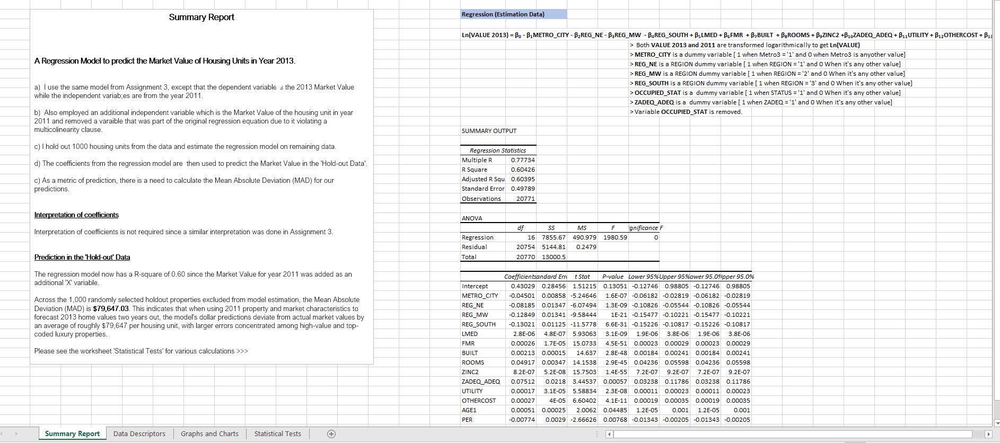
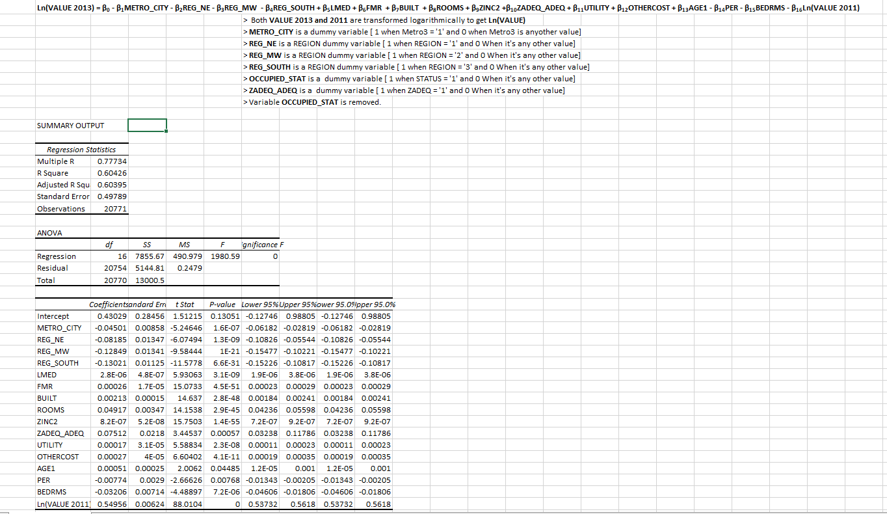
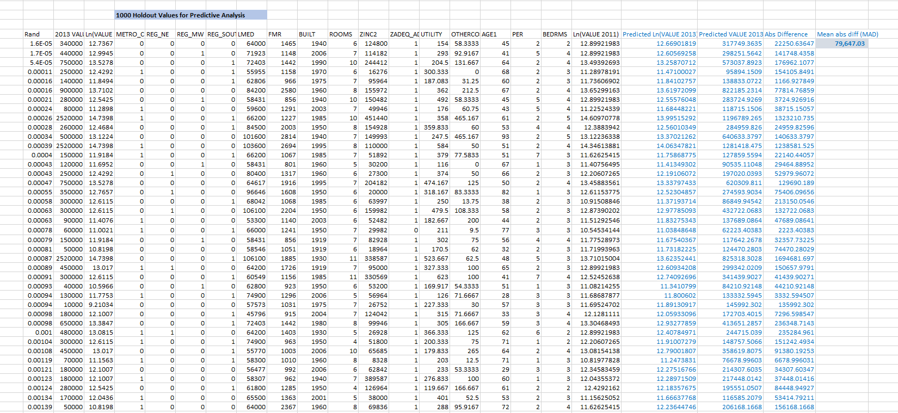

# Forecasting 2013 Housing Market Values from 2011 Data (Holdout & Regression Analysis)

## Project Overview
This project builds a longitudinal semi-log multiple regression model in Excel using American Housing Survey / Housing Affordability Data System (AHS/HADS) data to predict **2013 single-family housing market values** (`Ln(VALUE 2013)`) from **2011 predictors**, including lagged property value (`Ln(VALUE 2011)`). Out-of-sample predictive performance is evaluated on a **1,000-unit holdout sample** using Mean Absolute Deviation (MAD).

## Data Preparation & Sample Design
* **Longitudinal Matching & Filtering:** Matched housing units across 2011 and 2013 waves using the `CONTROL` identifier, retaining common units filtered to single-family homes (`TYPE = 1`, `STRUCTURETYPE = 1`) with valid market values (`VALUE >= $1,000`).
* **Predictor Updates:** Incorporated 2011 independent variables plus lagged `Ln(VALUE 2011)` as an additional predictor to improve explanatory and forecasting power.
* **Zero-Variance Removal:** Dropped `OCCUPIED_STAT` from the model because it had zero variance in the filtered longitudinal sample (causing `#DIV/0!` errors in correlation calculations and multicollinearity/redundancy issues).
* **Train / Holdout Split:** Held out **1,000 housing units** (`=RAND()`, pasted as values and sorted) for out-of-sample testing and estimated the regression on the remaining **20,771 estimation observations**.

## Model Specification & Variable Definitions
Both `2013 VALUE` and `2011 VALUE` are natural-log transformed (`Ln(VALUE)`) to address right-skewness and support semi-log percentage interpretations:

$$\text{Ln}(\text{VALUE 2013}) = \beta_0 + \beta_1\,\text{METRO\_CITY} + \beta_2\,\text{REG\_NE} + \beta_3\,\text{REG\_MW} + \beta_4\,\text{REG\_SOUTH} + \beta_5\,\text{LMED} + \beta_6\,\text{FMR} + \beta_7\,\text{BUILT} + \beta_8\,\text{ROOMS} + \beta_9\,\text{ZINC2} + \beta_{10}\,\text{ZADEQ\_ADEQ} + \beta_{11}\,\text{UTILITY} + \beta_{12}\,\text{OTHERCOST} + \beta_{13}\,\text{AGE1} + \beta_{14}\,\text{PER} + \beta_{15}\,\text{BEDRMS} + \beta_{16}\,\text{Ln}(\text{VALUE 2011})$$

* **Binary / Dummy Indicators:**
  * `METRO_CITY`: `1` if central city (`METRO3 = '1'`), `0` otherwise.
  * `REG_NE`, `REG_MW`, `REG_SOUTH`: Regional indicators (`1` for Northeast, Midwest, or South respectively; `0` otherwise, with West as the reference category).
  * `ZADEQ_ADEQ`: `1` if housing unit is physically adequate (`ZADEQ = '1'`), `0` otherwise.
* **Continuous / Count Predictors:** `LMED` (area median income), `FMR` (fair market rent), `BUILT` (year built), `ROOMS` (room count), `ZINC2` (household income), `UTILITY`, `OTHERCOST`, `AGE1` (householder age), `PER` (number of persons), `BEDRMS` (bedroom count), and `Ln(VALUE 2011)` (logged 2011 property value).

## Regression Results (Estimation Sample, $N = 20,771$)
* **Multiple $R$:** `0.77734`
* **$R^2$:** `0.60426` (`Adjusted R Square = 0.60395`)
* **Standard Error:** `0.49789`
* **ANOVA:** Model $F(16, 20754) = 1980.59$ ($\text{Significance } F \approx 0$; $\text{Regression SS} = 7855.67$, $\text{Residual SS} = 5144.81$, $\text{Total SS} = 13000.5$).

### Estimated Coefficients Summary
| Variable | Coefficient | Std. Error | $t$-Stat | $p$-Value |
| :--- | :---: | :---: | :---: | :---: |
| Intercept | `0.43029` | `0.28456` | `1.51215` | `0.13051` |
| `METRO_CITY` | `-0.04500` | `0.00858` | `-5.2465` | `1.6E-07` |
| `REG_NE` | `-0.08190` | `0.01347` | `-6.0749` | `1.3E-09` |
| `REG_MW` | `-0.12850` | `0.01341` | `-9.5844` | `1E-21` |
| `REG_SOUTH` | `-0.13020` | `0.01125` | `-11.578` | `6.6E-31` |
| `LMED` | `2.8E-06` | `4.8E-07` | `5.93063` | `3.1E-09` |
| `FMR` | `0.00026` | `1.7E-05` | `15.0733` | `4.5E-51` |
| `BUILT` | `0.00213` | `0.00015` | `14.637` | `2.8E-48` |
| `ROOMS` | `0.04917` | `0.00347` | `14.1538` | `2.9E-45` |
| `ZINC2` | `8.2E-07` | `5.2E-08` | `15.7503` | `1.4E-55` |
| `ZADEQ_ADEQ` | `0.07512` | `0.02180` | `3.44537` | `0.00057` |
| `UTILITY` | `0.00017` | `3.1E-05` | `5.58834` | `2.3E-08` |
| `OTHERCOST` | `0.00027` | `4.0E-05` | `6.60402` | `4.1E-11` |
| `AGE1` | `0.00051` | `0.00025` | `2.0062` | `0.04485` |
| `PER` | `-0.00770` | `0.00290` | `-2.6663` | `0.00768` |
| `BEDRMS` | `-0.03210` | `0.00714` | `-4.489` | `7.2E-06` |
| `Ln(VALUE 2011)` | `0.54956` | `0.00624` | `88.0104` | `0` |

## Holdout Validation & Prediction Accuracy ($N = 1,000$)

Using the regression estimates from the 20,771 training units, out-of-sample predictions were generated for the 1,000 held-out units, converted back to dollar values, and evaluated via **Mean Absolute Deviation (MAD)**:

$$\text{MAD} = \frac{1}{1000}\sum_{i=1}^{1000} \left|\text{Actual 2013 VALUE}_i - \text{Predicted 2013 VALUE}_i\right| = \$79,647.03$$

* Adding `Ln(VALUE 2011)` raised model explanatory power to an **$R^2$ of ~`0.60` (`0.60426`)**.
* Across the 1,000 unseen holdout homes, predictions deviate from actual 2013 values by an average of **$79,647.03** per unit, with larger dollar errors occurring on high-value / top-coded properties.

## Files in This Repository
* [Regression Analysis Prediction](~$regression_analysis_predictions.xlsx) — Data cleaning, descriptive statistics, regression output, statistical tests, and 1,000-unit holdout MAD calculation.